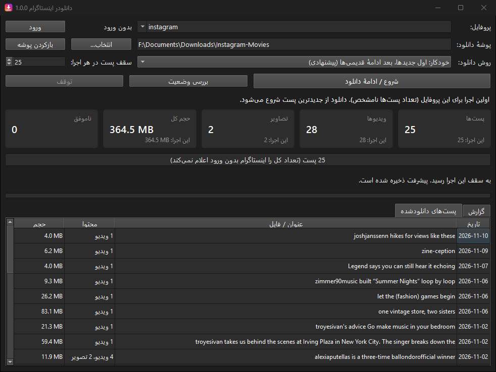
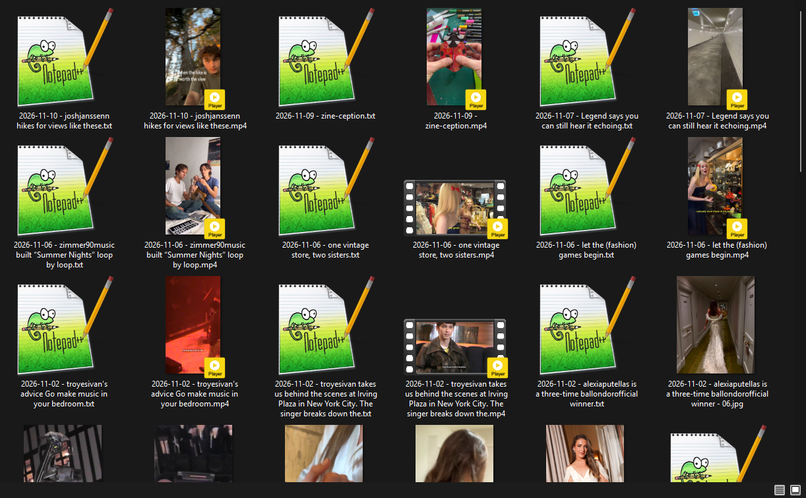

# Instagram Downloader

A Windows desktop app (Python, Qt) that downloads every post of a public Instagram profile into one folder, names each file by upload date and post title, saves each caption as a text file, and resumes where it stopped.



**Download:** get the ready-to-run `InstagramDownloader.exe` (single file, no Python installation needed) from [Releases](https://github.com/barbababak/InstagramDownloader/releases/latest).

## Features

- Downloads videos, images and multi-item posts. Video posts are saved without their cover thumbnail.
- File names start with the upload date, then the post title (the first caption line, without hashtags or emoji):
  `2026-10-08 - Post title.mp4`. A post without a title gets a random 10-digit number instead.
- The items of a multi-item post keep their order: `... - 01.jpg`, `... - 02.mp4`, `... - 03.jpg`.
- Each post's full caption is saved next to its media as `2026-10-08 - Post title.txt`.
- Each file's modified date is set to the post's upload date.
- Resumable in both directions. Progress is saved after every post, so the app knows which posts are done. When you run it again later, it downloads the new posts first and then continues with the older ones it has not reached yet. Pinned posts are handled correctly.
- Download modes: automatic (new, then old), only new posts, only older posts, a full check that restores deleted files, and captions only (no media).
- Shows live progress: posts, videos and images, total size, failed posts, download speed, and a table of downloaded posts.
- Stop at any time; there is also an optional limit on posts per run.
- `_posts.csv` in each profile folder lists every file with its post link, position in the post and full caption.
- Works without logging in for public profiles. If Instagram asks for a login, the app can use the session of a browser where you are logged in, or a pasted `sessionid` cookie. It never asks for your password.
- Persian (right-to-left) interface. Settings are kept in `settings.json` next to the exe.



## Quick start

Download `InstagramDownloader.exe` from [Releases](https://github.com/barbababak/InstagramDownloader/releases/latest), put it in a folder where it can write (not Program Files), and double-click it. Enter a profile name or URL, choose the download folder, and click the start button.

### Run from source

Requires Windows and Python 3.10 or later.

```bash
git clone https://github.com/barbababak/InstagramDownloader.git
cd InstagramDownloader
py -3 -m venv .venv
.venv\Scripts\python.exe -m pip install -r requirements.txt
.venv\Scripts\python.exe main.py
```

Or double-click `run.bat`, which does the same setup on its first run.

### Build the exe

Double-click `build_exe.bat`. It installs PyInstaller and writes `InstagramDownloader.exe` next to it. Run it again after updating `instaloader`, because the exe includes its own copy.

### Tests

```bash
.venv\Scripts\python.exe -m pip install pytest
.venv\Scripts\python.exe -m pytest tests
```

## Documentation

- [راهنمای فارسی کاربر (Persian user guide)](docs/USER-GUIDE-fa.md): file names, download modes, login and every setting.

## Project layout

| Path | Purpose |
|---|---|
| `igdl/engine.py` | Decides which posts to download and in what order; keeps the state current |
| `igdl/state.py` | Per-profile progress in `_state.json`, `_resume.json` and `_posts.csv` |
| `igdl/source.py` | Instagram access through [instaloader](https://github.com/instaloader/instaloader) |
| `igdl/naming.py` | Safe Windows file names from dates and captions |
| `igdl/gui.py` | The PySide6 interface |
| `igdl/auth.py` | Reads login cookies from a browser or pasted text |
| `tests/` | Tests for the sync logic and file naming, run against a simulated feed |

## Notes

- Only download content you have the right to keep, and respect Instagram's terms of use. Heavy downloading can get an account or IP address rate-limited; use a secondary account if you need to log in.
- Stories and highlights are not downloaded, only the posts of the profile's feed.
- Instagram changes its website often. If downloads start failing, update `instaloader` and rebuild the exe.
